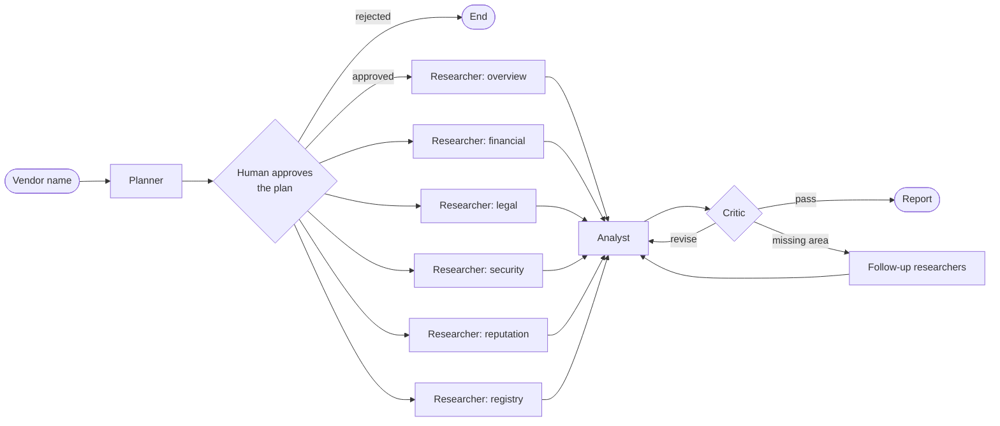

# Diligence Agents

**Multi-agent vendor due diligence on LangGraph: plan, research in parallel, analyze, and a critic that checks every claim.**

Give it a vendor name. A **planner** breaks the review into research tasks, **you approve the plan**, **researcher** agents investigate each area in parallel, an **analyst** writes a risk report with a recommendation, and a **critic** verifies every claim against its cited source and sends the report back until it holds up. The repo also benchmarks this against a **single-agent** baseline on quality, cost and time.

> All companies and documents in `data/` are fictional, created for the benchmark.

---

## Why multi-agent, and when not

One model call with one big retrieval is cheaper, but it mixes up entities, skips areas it didn't retrieve, and has nobody checking its work. Splitting the job lets each agent use a focused query and a narrow prompt, and gives you a checkpoint (the critic) before anything reaches a person. The cost is more calls and tokens. This repo measures that trade-off instead of assuming it.

## Architecture



- **LangGraph** `StateGraph` with `Send` for parallel fan-out, reducers to merge findings, conditional edges for the critic loop, and `interrupt()` + a checkpointer for the human approval pause (`diligence/graph.py`).
- **Structured outputs**: every agent returns a Pydantic model; with Claude, each call is a forced tool call on that schema, retried once with the validation error.
- **Tools**: BM25 search over a document corpus and a company-registry lookup with fuzzy name matching.
- **Cost tracking** per agent and per run.

### Guards in code, not prompts

| Guard | What it stops |
| --- | --- |
| Researchers can only cite evidence they were given | Invented citations (removed and counted) |
| Critic checks run in code | Claims whose cited text doesn't support them; claims citing another company's documents |
| Required-coverage check | Silent gaps: no financial or registry evidence becomes an `information_gap` risk with a condition |
| Hard-block policy | Approving a vendor with a sanctions match, suspended registration, tax lien or ongoing fraud case |
| The model can't overrule a failed check | A critic model saying "looks fine" when the code found problems |
| Revision cap and no repeat research | Infinite critic loops |

Tests use deliberately bad fake models: one researcher that invents "50,000 employees" and a fake press release, and one analyst that approves everything. The critic catches the first and the analyst drops the claim on the next round. The policy check blocks the second.

## Benchmark

Six vendors with a known correct outcome: healthy, remediated breach, fraud plus tax lien, going-concern warning, a lawsuit **later dismissed** (the system has to reconcile two sources), and a four-month-old shell company. Same tools and data for both architectures. Reproduce with `make eval`.

| Metric | Multi-agent | Single agent |
| --- | --- | --- |
| Correct recommendation | **6 / 6** | 4 / 6 |
| Must-find risk flags found | 100% | 100% |
| False risk flags | **0** | 4 |
| Claims supported by their citation | **100%** | 69% |
| Claims citing a different company | **0** | 39 |
| Model calls per vendor | 9 | 1 |
| Tokens per vendor | ~6,100 | ~1,600 |
| Estimated cost per vendor | ~$0.036 | ~$0.016 |

**How to read this honestly:** these numbers come from the offline, deterministic "model" (`diligence/fake.py`) that follows the same contracts as Claude, so they measure the **architecture** (scoped retrieval, decomposition, verification), not a language model. The single agent's main failure is real and common: one broad search pulls in documents about other companies, and nothing checks the result. A strong model would ignore some of that noise, so expect the gap to shrink with Claude. Measuring that is the next step: `DILIGENCE_LLM=claude python eval/run_eval.py`. Multi-agent costs about 2.3x more per vendor here; whether that's worth it depends on the cost of a wrong vendor decision.

## Quick start

```bash
git clone https://github.com/Faisal-161/diligence-agents && cd diligence-agents
python -m venv .venv && source .venv/bin/activate
pip install -e ".[ui,dev]"

diligence run "Summit Print Co" --trace           # multi-agent on LangGraph
diligence run "Summit Print Co" --review          # approve the plan in the terminal first
diligence run "Greenleaf Facilities Co." --single # single-agent baseline
make test                                         # includes LangGraph and bad-model tests
make eval                                         # benchmark
make ui                                           # Streamlit demo
```

### Use Claude

```bash
pip install -e ".[llm]"
export DILIGENCE_LLM=claude ANTHROPIC_API_KEY=sk-ant-...
python eval/run_eval.py
```

Set `DILIGENCE_PRICE_INPUT_PER_M` and `DILIGENCE_PRICE_OUTPUT_PER_M` to your model's current prices for accurate cost numbers.

### Human approval with LangGraph

```python
from langgraph.types import Command
from diligence.agents import Deps
from diligence.graph import build_graph

graph = build_graph(Deps.from_settings(), human_review=True)
config = {"configurable": {"thread_id": "vendor-42"}}
graph.invoke({"company": "Orion Data Labs Inc."}, config)     # pauses before research
print(graph.get_state(config).values["plan"])                 # show the plan to a person
graph.invoke(Command(resume={"approved": True}), config)      # or pass an edited "plan"
```

### Deploy the demo (free)

On [Streamlit Community Cloud](https://share.streamlit.io): **Create app** → this repo, branch `main`, main file `ui/app.py`.

## Project layout

```
diligence/
  agents.py    planner, researcher, analyst, critic, single-agent baseline, code guards
  graph.py     LangGraph StateGraph: Send fan-out, critic loop, interrupt for human review
  local.py     same flow without LangGraph (thread pool), used for tests
  llm.py       Claude (forced tool calls, retry on invalid output) and the offline fake
  fake.py      deterministic agent behaviour for offline runs
  tools.py     BM25 corpus search, registry lookup, claim-support scoring
  models.py    Pydantic schemas shared by all agents
  report.py    Markdown report with numbered citations
eval/          cases with ground truth and the multi vs single benchmark
ui/            Streamlit demo with plan review
```

## Roadmap

- [ ] Claude results for both architectures
- [ ] Web search tool for real vendors, with source-quality scoring
- [ ] Hand-off to [DocFlow Agent](https://github.com/Faisal-161/docflow-agent): approved vendors flow into invoice processing
- [ ] LangSmith or OpenTelemetry tracing

## About

Built by **Md Faisal Islam**, AI Engineer. Also see [MedTrace](https://github.com/Faisal-161/medtrace) (citation-grounded medical RAG) and [DocFlow Agent](https://github.com/Faisal-161/docflow-agent) (agentic invoice processing with human approval). faisalislam1610@gmail.com

MIT License.
